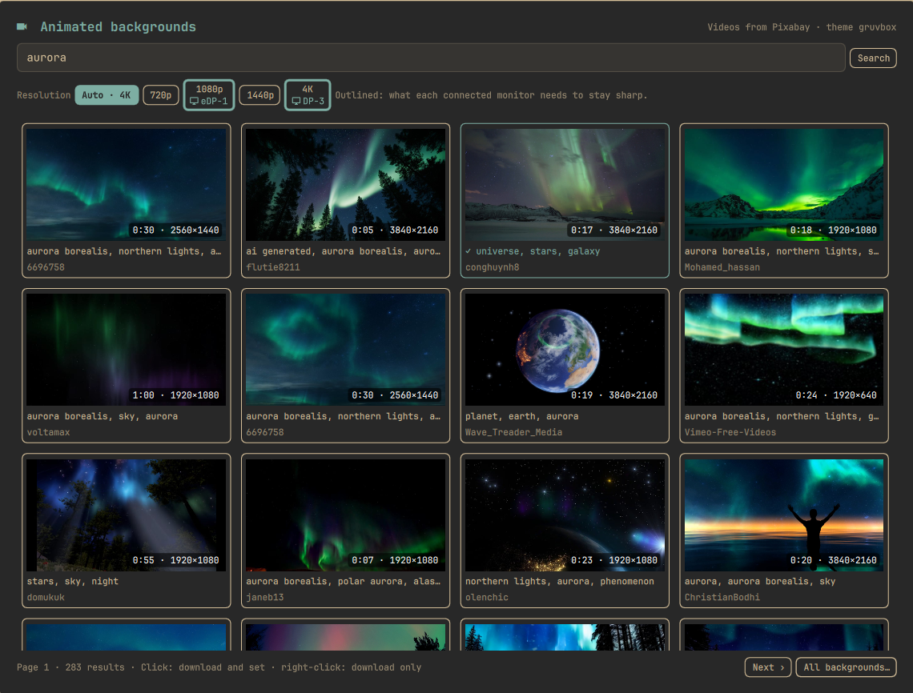

# Livewall

Search free video wallpapers on Pixabay from your Omarchy desktop and set one as your animated background with a single click.



Omarchy 4.5 can already play video backgrounds through its own engine, owe. Livewall adds the missing piece: a way to find and download videos. Each one is saved to the current theme's backgrounds folder, so it also appears in Omarchy's own background picker (`Super + Ctrl + Space`).

## Features

- Search Pixabay's free video library from a shell panel, with thumbnails, duration and resolution.
- Click a video to download it and set it as your background. Right-click downloads it without setting it.
- **Resolution selector**: Auto, 720p, 1080p, 1440p or 4K. Livewall reads your connected monitors from Hyprland and outlines the resolution each one needs to stay sharp. An ultrawide 3440×1440 screen needs a 4K source, because a 16:9 video must be 3440 px wide to fill it. Auto picks the resolution that covers every monitor. When a video isn't available at the chosen size, the largest smaller version is used.
- Search in your own language. Pixabay understands 26 languages, and Livewall sends the one you picked in Omarchy's Setup > Language.
- Interface in English, Italian, German, French, Spanish, Portuguese (European and Brazilian), Dutch and Polish. It follows Omarchy's language live, and any other language falls back to English.
- Videos you have already downloaded are marked ✓.
- **Downloaded** tab: every video already in your backgrounds folders, with thumbnail, length, resolution and size. Click one to set it, click the trash icon twice to delete it (the current background is protected). Filter by the current theme or show all themes.
- **Add your own videos** (MP4, WebM, MKV, MOV, M4V) with *Add videos…*, which opens the desktop file chooser, or by dropping files from the file manager onto the panel. They are copied into the current theme's backgrounds folder; the originals stay where they are.

## Requirements and external dependencies

- Omarchy 4.5 or later: video backgrounds are played by owe, Omarchy's background engine.
- `python3`, which Omarchy already ships. Livewall uses only the standard library: no pip packages, no binaries, no installer and no background service.
- `ffmpeg`/`ffprobe` (optional) for thumbnails and details of videos you add yourself.
- `hyprctl` (part of Hyprland) to read the connected monitors, and `omarchy theme bg set` to apply a background.
- A free Pixabay API key (see below). Pixabay is an external web service: searches and downloads go to `pixabay.com` and `cdn.pixabay.com`.

Livewall never needs root, never changes your configuration on its own and only sets a background when you click a video.

## Install

```bash
omarchy plugin add https://github.com/TinyWorkshopDesign/omarchy-livewall.git --enable
```

This adds a 󰕧 icon to the bar. You can also open the panel with:

```bash
omarchy-shell shell toggle tinyworkshop.livewall
```

To open straight on the downloaded videos:

```bash
omarchy-shell shell toggle tinyworkshop.livewall '{"view":"library"}'
```

To add an entry to the Omarchy menu, put this line in `~/.config/omarchy/extensions/omarchy-menu.jsonc`:

```jsonc
"install.style.livewall": {"icon":"󰕧","label":"Livewall (animated backgrounds)","action":"omarchy-shell shell toggle tinyworkshop.livewall"},
```

Update with `omarchy plugin update tinyworkshop.livewall`.

## Remove

```bash
omarchy plugin remove tinyworkshop.livewall
```

This removes the plugin and its bar icon; Omarchy keeps a backup of the plugin folder. Your downloaded videos, saved key and cache are left alone. To delete them too:

```bash
rm -rf ~/.local/state/livewall ~/.cache/livewall
rm -f ~/.config/omarchy/backgrounds/*/pixabay-*.mp4 ~/.config/omarchy/backgrounds/*/pexels-*.mp4
```

If you added the menu entry, delete the `install.style.livewall` line from `~/.config/omarchy/extensions/omarchy-menu.jsonc`.

## Getting a Pixabay key

1. Create a free account on [pixabay.com](https://pixabay.com).
2. While signed in, open [pixabay.com/api/docs](https://pixabay.com/api/docs/). Your key is shown under **Parameters**, next to `key`.
3. Paste it into the Livewall panel. Livewall checks the key with Pixabay before saving it.

The key is stored in `~/.local/state/livewall/pixabay.key` with mode `0600`.

**Pexels:** Pexels has paused issuing new API keys. If you already have one, save it as `~/.local/state/livewall/pexels.key` (or set `PEXELS_API_KEY`). Livewall uses Pexels only when no Pixabay key is present.

## Where things go

| What | Where |
|---|---|
| Downloaded videos | `~/.config/omarchy/backgrounds/<theme>/pixabay-<id>-<res>p-<name>.mp4` |
| API keys, resolution choice | `~/.local/state/livewall/` |
| Thumbnails, 24-hour search cache, video info | `~/.cache/livewall/` |

Videos are large: 1–2 MB per second at 1080p, and more at 4K. Delete the ones you don't want from the backgrounds folder.

If your `~/.config` is a git repository (dotfiles), add `*.mp4` under `omarchy/backgrounds` to `.gitignore`.

## Privacy and safety

- Livewall contacts only `pixabay.com` and `cdn.pixabay.com` (or `api.pexels.com`, `images.pexels.com` and `videos.pexels.com` with a Pexels key), over HTTPS. URLs pointing anywhere else are dropped.
- Nothing runs in the background: the network is used only when you search or download.
- Searches are cached for 24 hours, as Pixabay's API terms ask. Repeating a search costs no requests.
- Responses, thumbnails and videos have size limits. A download is kept only if it really is an MP4.
- All text that comes from the network is shown as plain text, never as rich text. No user input ever goes through a shell.
- Videos you add are copied as private files (readable only by you), and thumbnails, video details and the search cache in `~/.cache/livewall/` are private too. Livewall 1.1.1 also tightens a cache left readable by 1.1.0.
- `ffmpeg`/`ffprobe` read local files only: a file that is really a playlist cannot make them fetch anything from the network.

## Licensing of the videos

Videos come from [Pixabay](https://pixabay.com) under the [Pixabay Content License](https://pixabay.com/service/terms/). Please read it, especially before using a video for anything other than your own desktop. Livewall is not affiliated with Pixabay or Pexels.

## Development

```bash
cd ~/.config/omarchy/plugins/tinyworkshop.livewall
python3 -m unittest discover -s tests
omarchy plugin validate .
```

`livewall.py` does all the network work and answers in JSON lines, so you can try it directly: `./livewall.py search "rain" 1 en 1080`. Translations live in `i18n/`, with one flat JSON file per Omarchy language code. Pull requests with new languages are welcome.

## License

MIT © Tiny Workshop Design
